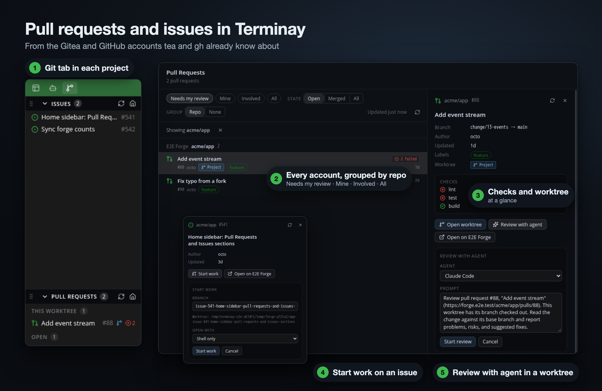
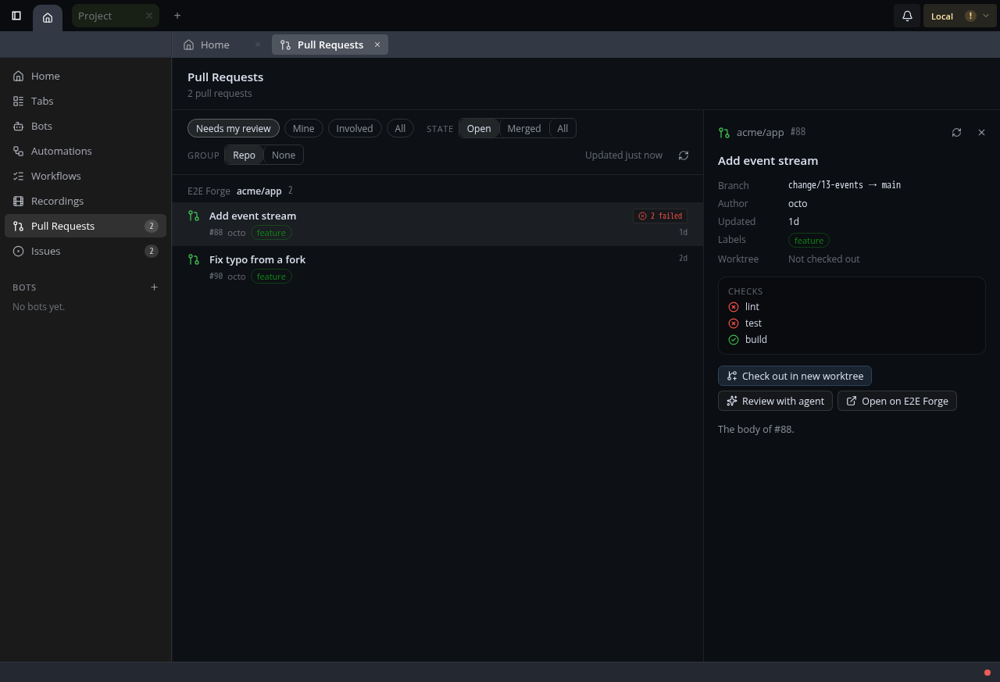
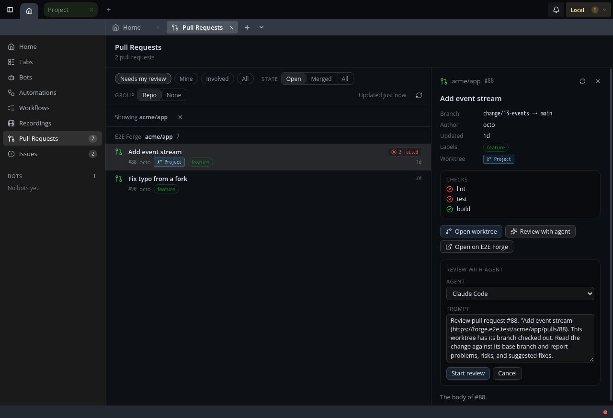
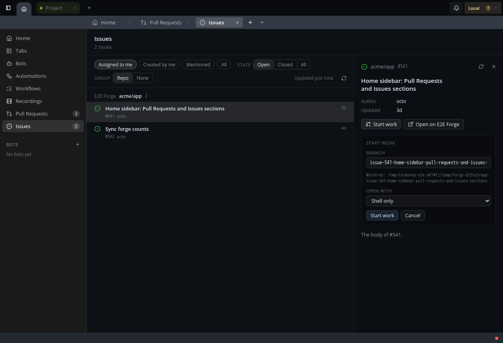
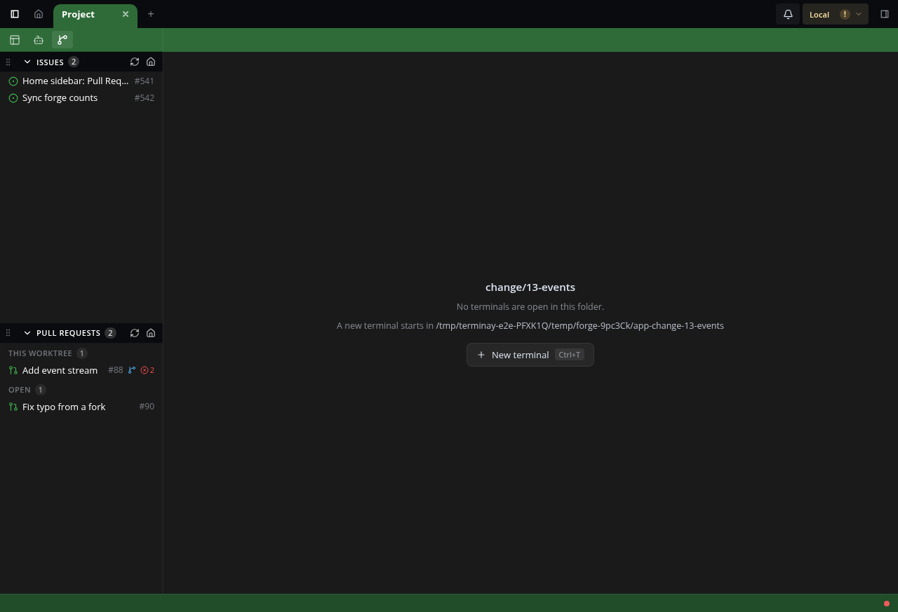

---

title: "Pull requests and issues in Terminay"
date: "2026-11-11"
tags: ["Terminay", "Gitea", "GitHub", "Extensions", "Claude Code", "OpenSpec"]
excerpt: "I asked whether tea could list every pull request I have. By the end of the morning Terminay had Pull Requests and Issues on its Home page, a Git tab in each project, and an extension API that lets the Gitea and GitHub extensions fill them."
---



This started with a small question. I asked Claude Code whether the `tea` CLI could list all the pull requests across all my projects.

It can. Run this outside a repository and it searches every repo you have access to:

```sh
tea issues list --kind pulls --fields index,title,owner,repo,updated
```

It found two open pull requests, one on Terminay and one on a hello-world repo. If you run it inside a repository, you only get that repository's pull requests.

Seeing that list made me want it inside [Terminay](https://terminay.com). Without it, you go to a browser to find the pull request, then come back, set up a worktree and start an agent by hand. Terminay already knew some of this. The Gitea and GitHub extensions show a worktree's pull request and CI state in the folders tree, but only for the branch that worktree is on, and only inside a project.

## What I asked for

Two new items on the Home page, **Pull Requests** and **Issues**. Configuration would go in the extension settings, but it should auto-detect as much as possible.

Terminay has built-in extensions for Gitea and GitHub, and I wanted those extensions to be responsible for this. So pull requests and issues would be exposed through the extension API, and the Gitea and GitHub extensions would do the work of fetching them. Both forges can list issues and pull requests, so there was no reason for Terminay itself to know about either one.

I also wanted something in a project's left sidebar. If the project is a Git repository on Gitea or GitHub, show its issues and pull requests there, and clicking one takes you to the full view on Home.

## Five mockups first

Before any code, I asked for five mockups as artifacts I could click through:

1. Home › Pull Requests, across every repo, filterable by Needs my review, Mine, Involved and All
2. Home › Issues, with a **Start work** button
3. The project left column
4. Settings › Extensions, with the accounts it found and which repos to include
5. The extension API

The first round worked, but it didn't look like Terminay. I sent screenshots of the real app and asked for the mockups to match. Claude Code pulled the actual CSS values out of the app (Open Sans, the neutral surfaces, the pill chips, the settings layout, the same lucide icons) and redid all five.

After that, the only thing I spotted was that Pull Requests grouped rows under the repository name and Issues didn't. Issues got the same grouping.

## Where the tokens come from

Then I asked how we get the accounts. Do we use `tea` and `gh` to grab a token and then call the API? Use the CLIs for everything? A mix?

It's a mix, and an earlier decision in Terminay (ADR-0063) already covered it. The CLIs are only used to get a token. Every list and detail request goes straight to the forge's API over HTTPS.

- **Gitea**: the extension reads `tea`'s `config.yml` directly and never runs `tea`.
- **GitHub**: `gh` keeps tokens in the keychain, so the extension runs `gh auth token --hostname <host>` once per host, and again only if the token is rejected or gh's config changes.
- **Neither**: you can add a token through the existing sign-in prompt.

The new bit is finding accounts. Until now the extensions only looked up tokens for servers your Git remotes point at. Home needs every account you have, so they now read the full list from `tea`'s `logins:` and `gh`'s `hosts.yml`.

## Terminay asks, the extension answers

The main open question was in mockup five. Either Terminay asks an extension for a page of results when you open a list, or the extension keeps its own lists up to date and pushes them in.

We went with Terminay asking. "Everything I can access" on a big GitHub organisation can't be held as a complete list, and it's only worth fetching while someone is looking at it. So there's a new extension contribution, `forgeSources`, and a source only has to answer four questions:

- Which accounts do you have?
- Do you claim this Git remote?
- Give me one page of items for this query.
- Give me the detail for this one item.

A source keeps no list state. It can send a hint that results for a forge have changed, and Terminay decides what to do with it.

Everything else stays in Terminay. It validates what comes back, caches it for up to 60 seconds, merges results from several accounts, and draws the UI. Sources send facts, never presentation. Working out whether a pull request's branch is already checked out in one of your worktrees is also Terminay's job, because a source never learns about projects, worktrees or terminals.

Lists refresh when you open them, when you change the filter, when you press Refresh, and when a source sends a hint. There's no timer. Terminay has a rule against polling without my approval, and a background refresh of every repo I can access would be exactly that.

This also means a GitLab extension, or any other forge, gets the Home sections and project tabs by implementing those four calls. It doesn't have to build any UI.

## How it got built

I have a workflow in Terminay for this kind of change. Each step is a prompt the agent works through in order:

1. Write an [OpenSpec](https://github.com/Fission-AI/OpenSpec) proposal from the conversation, without reopening anything we'd settled
2. Have Codex review the proposal
3. Fold the findings Claude Code agrees with into the proposal
4. Implement it
5. Verify the implementation against the specs
6. Run the end-to-end tests and take screenshots
7. Open the pull request
8. Get CI green

Codex came back with 13 findings on the proposal, and all 13 went into the plan before any code was written. They were things like making sure a client bound to one project can't see account-wide lists, what happens when a page comes back half empty after filtering out merged pull requests, and how to quote an agent prompt safely across shells.

The end-to-end tests run against a fake forge extension that gets uploaded through Settings, the same way you'd install any extension. That's where the `acme/app` repository and the user `octo` in the screenshots below come from.

## What it looks like

**Pull Requests** on Home lists everything from every account it found, grouped by repository. There's a scope (Needs my review, Mine, Involved, All), a state, and a detail pane with the branch, the checks, and whether the branch is checked out anywhere.



From the detail pane you can open the worktree if the branch is already checked out, check it out into a new worktree, or **Review with agent**. That opens a terminal in the worktree running the agent you pick, with a prompt you can edit before it starts.



Getting the prompt into the agent needed a small change to how Terminay launches agents. A launcher can now say that its program takes a starting prompt as an argument, and Terminay quotes it for the shell it's running in. The built-in agents extension declares that for the agents that support it.

**Issues** works the same way, grouped by repository, with Assigned to me, Created by me, Mentioned and All. **Start work** creates a worktree on a branch named after the issue and opens a terminal there, either running an agent with a prompt built from the issue or with just a shell.



## The project tab, second try

The first version gave a project's left column two new tabs, Pull Requests and Issues, with a count on each. It worked, but I didn't like it.

So I asked for one **Git** tab instead, with two panes inside it: Issues first, then Pull Requests. They're sortable and collapsible, like the panes in the right sidebar, and Terminay remembers the layout on each device. I also asked for the rows to look like the rest of the app. They're now single lines in the same style as the Changes pane, with the branch details in a tooltip.



The tab only appears when a forge extension claims the project's remote. Pull Requests puts **This worktree** first, so the pull request for the branch you're on is at the top. Clicking a row opens Home with that item selected.

## How this helps

You can see what's waiting for you without leaving the terminal.

When someone asks you to review a pull request, it's under Needs my review. You can see whether CI passed, check the branch out into its own worktree, and start an agent on the review from the same pane, without copying a branch name out of a browser.

When you pick up an issue, Start work gives you a branch named after it, a worktree, and an agent with the issue already in its prompt.

Both work across every Gitea and GitHub account `tea` and `gh` already know about, so there's nothing to add again.

It's read-only for now. Commenting, reviewing and merging from Terminay would need a further extension contribution and its own decision record, so that's for another day.
