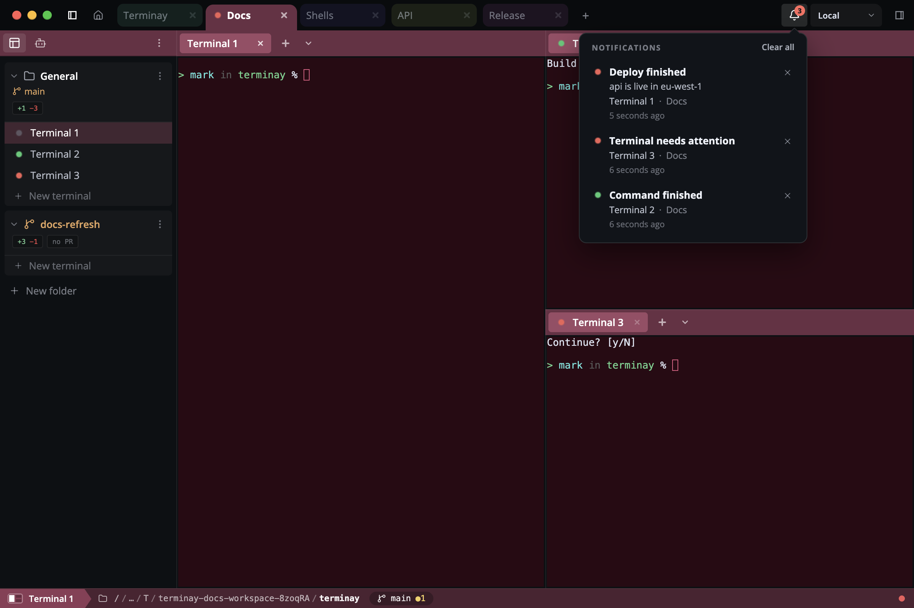
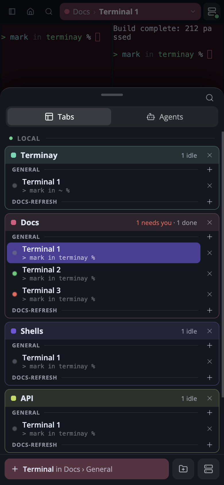

[Terminay](https://terminay.com) tells you when a terminal needs you. An agent finishes, a command ends, a script sends a message, and you get a count on the bell and a badge on the Dock icon.



That's fine while I'm sat at the desk. But the reason I start a long agent run is so I can walk away from it, and Terminay already has a web app at `app.terminay.com` that I install on my phone to reach my terminals remotely. So I wanted the same notifications there, as proper banners, with the app closed.

I had a short list of things it had to do:

- A banner has to say which terminal and which project. That's the whole point of it.
- The Home Screen icon gets a badge with the count, added up across every server the phone is paired with.
- If I deal with a notification on one device, it clears on all of them.
- The hosted service in the middle can never read any of it.
- One server can't show a banner pretending to be another.

## How Web Push works

There's no Apple developer account and no Firebase project in any of this. A PWA gets push through a web standard, and the part that identifies you as the sender is called VAPID. It's a key pair. You generate it once:

```js
const webpush = require('web-push')
console.log(webpush.generateVAPIDKeys())
```

The page gives the public key to the browser and asks for a subscription:

```js
const reg = await navigator.serviceWorker.register('sw.js')
await navigator.serviceWorker.ready
const subscription = await reg.pushManager.subscribe({
  userVisibleOnly: true,
  applicationServerKey: keyBytes(VAPID_PUBLIC_KEY),
})
```

What comes back is an address and two keys:

```json
{
  "endpoint": "https://web.push.apple.com/QIBHKuGI8oPR…",
  "keys": { "p256dh": "BHOatbNeIH-k5-j6z5A…", "auth": "v27zcB2JOhpl…" }
}
```

On an iPhone the address is at `web.push.apple.com`. On Chrome it's Google's. Anyone holding that JSON and the VAPID private key can send the device a push. The payload is encrypted to the device's keys, so Apple carries it without being able to read it. When it arrives, the browser wakes your service worker and hands it the payload in a `push` event, even if the app is closed.

On an iPhone there are two conditions. The app has to be installed to the Home Screen, because Safari gives a browser tab no push at all. And `subscribe()` has to run directly from a tap. We got that second one wrong at first. We asked for permission, the permission prompt used up the tap, and Safari then refused the subscription that followed.

We also had a service worker that never finished installing. It was being served with a content security policy that didn't let it fetch from its own origin, so it couldn't cache its files. Nothing about push works without an active service worker, and the error you get from `subscribe()` doesn't mention any of that.

## Keeping the middle blind

Something has to hold the subscription and make the call to Apple, and for Terminay that's the hosted service at `app.terminay.com`. I didn't want it to know anything.

So the phone makes a random key for each server it's paired with, and hands that key to the server over the encrypted connection between the two, which the hosted service can't read. The server encrypts every push with that key before it sends it. Every push is padded to the same 3072 bytes. The hosted service receives a sealed blob and a token, and passes the blob on.

On the phone, the service worker tries the push against the key for the server it claims to be from. If it doesn't open, it's ignored. A server only has its own key, so it can't put a banner on my phone in another server's name.

## "No, not on your phone"

I built all of this with Claude Code, across two repos, and once the early bugs were out the test went well. I ran a command, switched to my browser, and a banner arrived on my phone naming the terminal and the project.

Then I clicked into the terminal on my desktop. The Dock badge cleared. The banner on my phone stayed where it was, and so did the badge on the Home Screen icon.

I asked whether we were clearing them at all. The answer started:

> No, not on your phone while the PWA is closed.

Claude had built it that way on purpose. Its reasoning was that Apple requires every push to show a notification, and that a site sending pushes which show nothing gets its subscription revoked. So for iPhones the server never sent a "this has been cleared" push. And in case one arrived anyway, the service worker put up a placeholder banner saying "Open Terminay to see what is new", so that no push ever went by without showing something.

I didn't believe it, and I said so. Setting a badge to 0 is the same operation as setting it to 1. If a push can do one it can do the other.

It didn't back down, and it had sources. Apple's own documentation says:

> Safari doesn't support invisible push notifications. Present push notifications to the user immediately after your service worker receives them. If you don't, Safari revokes the push notification permission for your site.

It found blog posts and GitHub pull requests saying the same thing, and a number that keeps getting repeated, which is that three silent pushes get you cut off.

So we had documentation on one side and me being stubborn on the other. Arguing wasn't going to settle it. Testing in Terminay was slow, because every change to the server meant a desktop build.

## A throwaway test app

I asked for the smallest possible PWA instead, hosted on a static site. It has one button to subscribe and a text box showing the subscription JSON. There's no backend. I tapped the button on my phone, copied the JSON, and pasted it into the chat. Claude kept the VAPID private key on my laptop and sent pushes from there with a few lines of Node:

```js
webpush.setVapidDetails('mailto:me@example.com', vapid.publicKey, vapid.privateKey)
await webpush.sendNotification(subscription, JSON.stringify(push), { TTL: 60 })
```

The service worker does exactly what the push says and nothing else:

```js
self.addEventListener('push', (event) => event.waitUntil(handle(event)))

async function handle(event) {
  const push = event.data.json()

  if (push.close) {
    for (const shown of await self.registration.getNotifications()) shown.close()
  }
  if (typeof push.badge === 'number') {
    if (push.badge > 0) await self.navigator.setAppBadge(push.badge)
    else await self.navigator.clearAppBadge()
  }
  if (push.notify) {
    await self.registration.showNotification(push.notify.title, { body: push.notify.body })
  }
}
```

Then we went one step at a time, with the app closed on my phone and me reporting what I saw.

1. `{"badge":1}`. The icon got a badge of 1. No banner.
2. `{"badge":0}`. The badge went away. No banner.
3. A normal push with a banner and a badge of 1. Both appeared.
4. `{"badge":0,"close":true}`. The banner left Notification Centre and the badge cleared. No new banner.
5. `{"badge":2}`. The badge went to 2. No banner.

That last one was the fourth push that showed nothing, one past where the subscription was supposed to die. It was still working.

So an installed PWA on an iPhone can set its badge from a push, clear it, and remove a banner that's already on screen, all without showing anything new. The three calls that do it are `setAppBadge`, `clearAppBadge` and `getNotifications()` followed by `close()`, from inside the `push` handler.

## What Apple might still do

I don't want to oversell four pushes in a couple of minutes. Apple's documentation says what it says, and I haven't run this for weeks. It's possible that a subscription gets dropped after enough silent pushes over a longer stretch.

What people who've shipped this seem to do is not trust the subscription to last. Every time the app opens, check whether it still has one, and subscribe again if it doesn't. Permission has already been granted, so nobody gets asked twice. Terminay's web app already did that on every start and every time it came back to the foreground, so that part was free.

## What Terminay does now

The fix was small once I knew the limit wasn't real. The placeholder banner is gone, so a push that only changes the count shows nothing. The phone tells each server it accepts those pushes. When I click into a terminal on my desktop, the server sends the phone a sealed push that says "here is what's still outstanding", and the service worker closes any banner that isn't on that list and sets the badge to the new total.

Writing the docs for this is how I found out the phone layout had no notification list at all, so that got built too. The bell is at the top right and the list slides up from the bottom.



I haven't tested any of this on Android yet. Web Push and VAPID are the same there, but I don't know how the badge calls or a push that shows nothing behave in Chrome on a phone, so I'm not going to claim it works until I've held one and watched it.

If you're adding push to a PWA, build the throwaway test app first. Mine was one HTML file, one service worker, and a script on my laptop, and it told me what my phone does, which the documentation hadn't.
